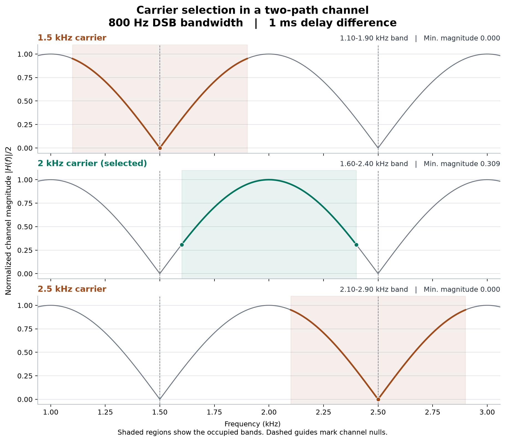

# A02 — Carrier selection in a two-path channel

## 1. Problem

A two-path channel has a delay difference of 1 ms. Choose a carrier of 1.5, 2.0, or 2.5 kHz for a double-sideband (DSB) signal with a total bandwidth of 800 Hz.

## 2. Derivation

Model the two paths as equal-gain copies with the same polarity. Taking the first path as the delay reference gives the following frequency response, with $f$ in Hz and $\Delta\tau=10^{-3}$ s.

```math
\begin{aligned}
h(t) &= \delta(t) + \delta(t-\Delta\tau), \\
H(f) &= 1 + e^{-j2\pi f\Delta\tau}
     = 2e^{-j\pi f\Delta\tau}\cos(\pi f\Delta\tau), \\
\frac{|H(f)|}{2} &= |\cos(\pi f\Delta\tau)|.
\end{aligned}
```

Adjacent peaks are 1 kHz apart. Peaks occur at integer multiples of 1 kHz, and nulls lie halfway between them at $(n+\tfrac12)$ kHz for integer $n$. A DSB signal occupies $[f_c-400, f_c+400]$ Hz on the positive-frequency side.

| Carrier | Occupied band | In-band null | Minimum $\lvert H(f)\rvert/2$ |
| ---: | ---: | ---: | ---: |
| 1.5 kHz | 1.1–1.9 kHz | 1.5 kHz | 0 |
| **2.0 kHz** | **1.6–2.4 kHz** | **None** | **0.3090** |
| 2.5 kHz | 2.1–2.9 kHz | 2.5 kHz | 0 |

**Choose 2.0 kHz.** Its band is centered on a constructive peak and clears the 1.5 and 2.5 kHz nulls by 100 Hz at each edge. The minimum normalized magnitude over this band occurs at both edges and equals $\cos(0.4\pi)\approx0.3090$. At 1.5 and 2.5 kHz, the central null also strongly attenuates nearby frequencies in both sidebands.

## 3. Project structure

```text
A02/
├── README.md
├── main.py
├── model.py
├── visualization.py
└── outputs/
    └── a02_visualization.png
```

- `main.py` prints the candidate comparison and saves the figure.
- `model.py` calculates the channel response, occupied bands, and carrier selection.
- `visualization.py` plots the channel response and compares the three occupied bands.

## 4. Run

From the `Assignments` directory, invoke its virtual environment directly.

```powershell
.\.venv\Scripts\python.exe -B .\A02\main.py
```

To save the figure to a different path, pass `--output`.

```powershell
.\.venv\Scripts\python.exe -B .\A02\main.py --output .\A02\outputs\result.png
```

## 5. Output


